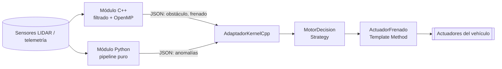

# Arquitectura y UML (Módulo POO en Java 17)

## Diagrama de clases
Visibilidades: `+` público, `-` privado, `#` protegido. Relaciones: generalización (`<|--`), realización (`<|..`), composición (`*--`), agregación (`o--`), dependencia (`..>`).

```mermaid
classDiagram
direction TB

class NivelRiesgo {
  <<enumeration>>
  BAJO
  MEDIO
  ALTO
  CRITICO
}

class Obstaculo {
  <<record>>
  +double distanciaM
  +double velocidadRelativaMs
  +double anchoLateralM
}

class EstadoVehiculo {
  <<record>>
  +double velocidadMs
  +double desaceleracionMaxMs2
}

class EventoTelemetria {
  <<record>>
  +long timestampMs
  +NivelRiesgo nivel
  +String descripcion
}

class EstrategiaEvaluacionRiesgo {
  <<interface>>
  +evaluar(Obstaculo obs, EstadoVehiculo est) NivelRiesgo
}
class RiesgoPorDistancia {
  -double umbralCriticoM
  -double umbralAltoM
  +evaluar(Obstaculo obs, EstadoVehiculo est) NivelRiesgo
}
class RiesgoPorTiempoColision {
  -double ttcCriticoS
  -double ttcAltoS
  +evaluar(Obstaculo obs, EstadoVehiculo est) NivelRiesgo
}

class ActuadorFrenado {
  <<abstract>>
  +ejecutarSecuenciaFrenado(double presion) ResultadoFrenado
  #verificarSistema() boolean
  #aplicarPresion(double presion) void
  #registrarEvento(String msg) void
}
class FrenoHidraulico {
  #verificarSistema() boolean
  #aplicarPresion(double presion) void
}
class FrenoRegenerativo {
  #verificarSistema() boolean
  #aplicarPresion(double presion) void
}
class ResultadoFrenado {
  <<record>>
  +boolean exitoso
  +double presionAplicada
}

class MotorDecision {
  -EstrategiaEvaluacionRiesgo estrategia
  -ActuadorFrenado actuador
  -List~EventoTelemetria~ historial
  +MotorDecision(EstrategiaEvaluacionRiesgo e, ActuadorFrenado a)
  +evaluarYActuar(Obstaculo obs, EstadoVehiculo est) NivelRiesgo
  +setEstrategia(EstrategiaEvaluacionRiesgo e) void
  +getHistorial() List~EventoTelemetria~
}

class ProveedorPercepcion {
  <<interface>>
  +obstaculoMasCercano() Optional~Obstaculo~
  +anomaliasRecientes() List~Anomalia~
}
class AdaptadorKernelCpp {
  -String rutaEjecutable
  +obstaculoMasCercano() Optional~Obstaculo~
  +anomaliasRecientes() List~Anomalia~
}
class Anomalia {
  <<record>>
  +long t
  +double valor
  +double zscore
}

EstrategiaEvaluacionRiesgo <|.. RiesgoPorDistancia
EstrategiaEvaluacionRiesgo <|.. RiesgoPorTiempoColision
ActuadorFrenado <|-- FrenoHidraulico
ActuadorFrenado <|-- FrenoRegenerativo
ProveedorPercepcion <|.. AdaptadorKernelCpp
MotorDecision o-- EstrategiaEvaluacionRiesgo : usa (Strategy)
MotorDecision o-- ActuadorFrenado : delega (Template Method)
MotorDecision *-- EventoTelemetria : historial
MotorDecision ..> ProveedorPercepcion : depende de abstracción (DIP)
ActuadorFrenado ..> ResultadoFrenado : crea
EstrategiaEvaluacionRiesgo ..> Obstaculo
EstrategiaEvaluacionRiesgo ..> EstadoVehiculo
EstrategiaEvaluacionRiesgo ..> NivelRiesgo
ProveedorPercepcion ..> Anomalia
EventoTelemetria --> NivelRiesgo
```

## Decisiones de diseño
- **Template Method:** `ejecutarSecuenciaFrenado()` es `final`: verifica → aplica presión → registra. Las subclases solo implementan los pasos variables (`verificarSistema`, `aplicarPresion`), con `registrarEvento` como *hook*.
- **Strategy:** `EstrategiaEvaluacionRiesgo` permite cambiar la política de riesgo (distancia vs. tiempo a colisión) sin tocar `MotorDecision` (OCP).
- **LSP:** cualquier `ActuadorFrenado` o estrategia es sustituible sin alterar la corrección del motor.
- **DIP:** `MotorDecision` depende de `ProveedorPercepcion`, no del ejecutable C++ ni de Python.
- **Aliasing:** `historial` es privado; `getHistorial()` devuelve `Collections.unmodifiableList(...)`; los datos de dominio son `record` inmutables.

## Flujo de datos e integración

