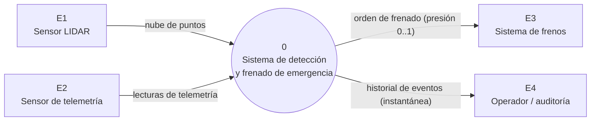
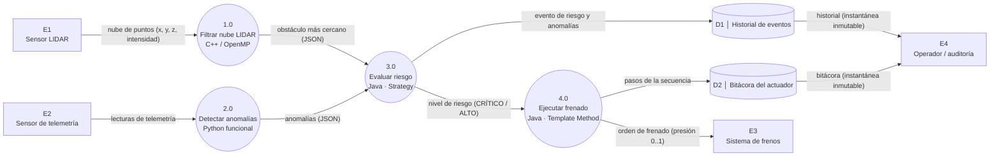
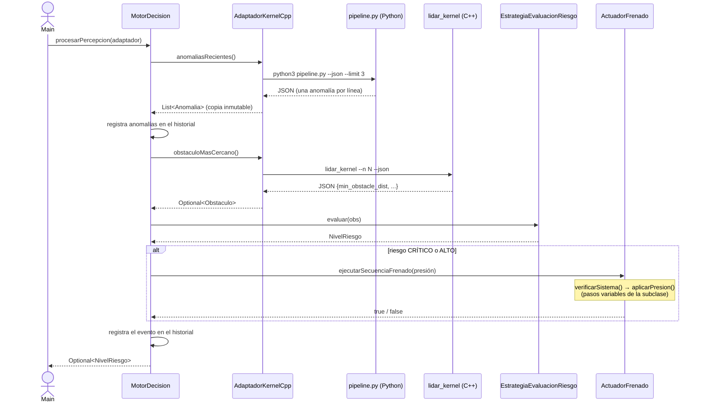

# Arquitectura y especificación UML

El módulo Java tiene **13 clases** (se eliminaron 4 que no eran esenciales: `EstadoVehiculo`, `ResultadoFrenado`, `JsonPlano` y `PercepcionException`).
Los diagramas están en Mermaid (se renderizan en GitHub/GitLab/VS Code). La versión en PDF, con las mismas figuras dibujadas con Graphviz, es `01_arquitectura_uml.pdf`.

## 1. Diagrama de clases (UML)
Visibilidades: `+` público, `-` privado, `#` protegido · `*` método abstracto · `$` estático.

```mermaid
classDiagram
direction TB

class NivelRiesgo {
  <<enumeration>>
  BAJO
  MEDIO
  ALTO
  CRITICO
}
class Obstaculo {
  <<record>>
  +double distanciaM
  +double velocidadRelativaMs
}
class Anomalia {
  <<record>>
  +long t
  +double valor
  +double zscore
}
class EventoTelemetria {
  <<record>>
  +NivelRiesgo nivel
  +String descripcion
}

class EstrategiaEvaluacionRiesgo {
  <<interface>>
  +evaluar(Obstaculo obs) NivelRiesgo
}
class RiesgoPorDistancia {
  -double umbralCriticoM
  -double umbralAltoM
  +evaluar(Obstaculo obs) NivelRiesgo
}
class RiesgoPorTiempoColision {
  -double ttcCriticoS
  -double ttcAltoS
  +evaluar(Obstaculo obs) NivelRiesgo
}

class ActuadorFrenado {
  <<abstract>>
  -List~String~ bitacora
  +ejecutarSecuenciaFrenado(double presion) boolean
  #verificarSistema()* boolean
  #aplicarPresion(double presion)* void
  #registrarEvento(String msg) void
  +getBitacora() List~String~
}
class FrenoHidraulico {
  -double nivelLiquido
  -double presionLineaBar
  #verificarSistema() boolean
  #aplicarPresion(double presion) void
}
class FrenoRegenerativo {
  -double cargaBateria
  -double torqueNm
  #verificarSistema() boolean
  #aplicarPresion(double presion) void
}

class ProveedorPercepcion {
  <<interface>>
  +obstaculoMasCercano() Optional~Obstaculo~
  +anomaliasRecientes() List~Anomalia~
}
class AdaptadorKernelCpp {
  -Path raiz
  -int nPuntos
  -double velocidadVehiculoMs
  -int limiteAnomalias
  +obstaculoMasCercano() Optional~Obstaculo~
  +anomaliasRecientes() List~Anomalia~
  +leerCampo(String json, String clave)$ double
  -ejecutar(List~String~ cmd, Path dir) List~String~
}

class MotorDecision {
  -EstrategiaEvaluacionRiesgo estrategia
  -ActuadorFrenado actuador
  -List~EventoTelemetria~ historial
  +MotorDecision(EstrategiaEvaluacionRiesgo e, ActuadorFrenado a)
  +evaluarYActuar(Obstaculo obs) NivelRiesgo
  +procesarPercepcion(ProveedorPercepcion p) Optional~NivelRiesgo~
  +setEstrategia(EstrategiaEvaluacionRiesgo e) void
  +getHistorial() List~EventoTelemetria~
  -frenar(double presion, String tipo) String
}

EstrategiaEvaluacionRiesgo <|.. RiesgoPorDistancia
EstrategiaEvaluacionRiesgo <|.. RiesgoPorTiempoColision
ActuadorFrenado <|-- FrenoHidraulico
ActuadorFrenado <|-- FrenoRegenerativo
ProveedorPercepcion <|.. AdaptadorKernelCpp
MotorDecision o-- EstrategiaEvaluacionRiesgo : estrategia
MotorDecision o-- ActuadorFrenado : actuador
MotorDecision *-- EventoTelemetria : historial 0..*
MotorDecision ..> ProveedorPercepcion : usa
EstrategiaEvaluacionRiesgo ..> Obstaculo
ProveedorPercepcion ..> Obstaculo
ProveedorPercepcion ..> Anomalia
EventoTelemetria --> NivelRiesgo

note for ActuadorFrenado "Template Method: ejecutarSecuenciaFrenado() es final y fija el orden verificar → aplicar → registrar"
note for EstrategiaEvaluacionRiesgo "Strategy: política de riesgo intercambiable (OCP)"
note for AdaptadorKernelCpp "Adapter: traduce JSON de C++ y Python a objetos del dominio"
```

Relaciones: `<|--` generalización · `<|..` realización · `o--` agregación · `*--` composición · `-->` asociación · `..>` dependencia.

## 2. Patrones GoF
| Patrón | Dónde | Justificación |
|---|---|---|
| **Template Method** | `ActuadorFrenado.ejecutarSecuenciaFrenado()` (`final`) | El orden verificar → aplicar → registrar es una regla de seguridad que ninguna subclase puede alterar. `FrenoHidraulico` y `FrenoRegenerativo` solo implementan los pasos variables; `registrarEvento` es un *hook*. |
| **Strategy** | `EstrategiaEvaluacionRiesgo` + 2 implementaciones | La política de riesgo cambia en ejecución (`setEstrategia`) sin modificar `MotorDecision`. |
| **Adapter** | `AdaptadorKernelCpp` implementa `ProveedorPercepcion` | Adapta procesos externos (C++, Python) y JSON a la interfaz que espera el dominio. Si se migra a JNI solo cambia esta clase. |

## 3. Principios SOLID
| Principio | Evidencia |
|---|---|
| **S** (responsabilidad única) | `MotorDecision` solo orquesta; las estrategias solo evalúan; el adaptador solo traduce. |
| **O** (abierto/cerrado) | Un freno o una política nuevos son clases nuevas; no se modifica código existente. |
| **L** (sustitución de Liskov) | Cualquier `ActuadorFrenado` o estrategia se puede usar donde se espera el tipo base (pruebas "LSP"). |
| **I** (segregación de interfaces) | Interfaces mínimas: `EstrategiaEvaluacionRiesgo` (1 método) y `ProveedorPercepcion` (2). |
| **D** (inversión de dependencias) | `MotorDecision` depende de abstracciones (`EstrategiaEvaluacionRiesgo`, `ActuadorFrenado`, `ProveedorPercepcion`), no de C++ ni de Python. |

## 4. Reglas de encapsulamiento
| Regla | Cómo se cumple |
|---|---|
| Campos privados | Todo el estado es `private`; los `record` tienen campos `final`. |
| Invariantes validados al construir | Constructores compactos de `record` y constructores de frenos/estrategias lanzan `IllegalArgumentException`. |
| **Sin aliasing de colecciones** | `getHistorial()` y `getBitacora()` devuelven `List.copyOf(...)`: una **instantánea inmutable**, no una vista de la lista interna. Los eventos nuevos no aparecen en ella y recorrerla no lanza `ConcurrentModificationException`. |
| Dependencias no nulas | `Objects.requireNonNull` en constructores y `setEstrategia`. |
| Seguridad entre hilos | Métodos públicos de `MotorDecision` y `ActuadorFrenado` son `synchronized`. |

## 5. Diagrama de flujo de datos (DFD, notación Yourdon–DeMarco)

**Notación:** rectángulo = entidad externa (E) · círculo = proceso numerado (1.0, 2.0…) · dos líneas paralelas = almacén de datos (D) · flecha rotulada = flujo de datos. Las entidades externas no se comunican directamente con los almacenes, y todo flujo entra o sale de un proceso.

### 5.1 Nivel 0 (diagrama de contexto)

### 5.2 Nivel 1 (descomposición del proceso 0)

### 5.3 Diccionario de datos
| Flujo | Contenido | Implementación |
|---|---|---|
| nube de puntos | arreglos `x, y, z, intensidad` (float) | `lidar::PointCloud` (C++, SoA) |
| obstáculo más cercano | distancia (m) o −1 si no hay | JSON de `lidar_kernel --json` → `Obstaculo` |
| lecturas de telemetría | `(t, valor)` | generador infinito `source_stream` → `Reading` |
| anomalías | `(t, valor, media, zscore)` | JSON de `pipeline.py --json` → `Anomalia` |
| nivel de riesgo | `BAJO`/`MEDIO`/`ALTO`/`CRITICO` | enum `NivelRiesgo` |
| orden de frenado | presión en [0, 1] | parámetro de `ejecutarSecuenciaFrenado` |
| historial / bitácora | lista de eventos | `List.copyOf(...)` (instantánea inmutable) |

## 6. Diagrama de secuencia (ciclo de decisión)

